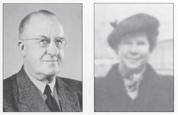
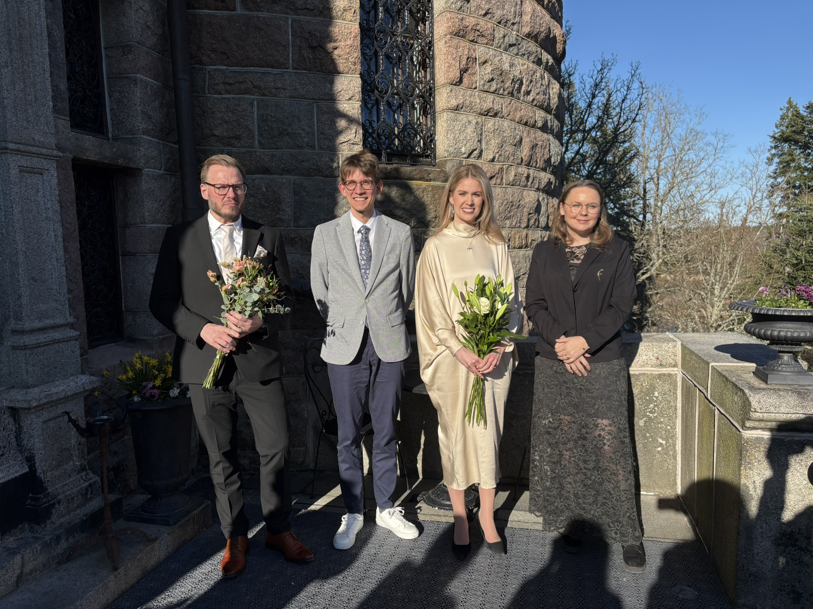

<section class="content--apply" markdown="1">

Stiftelsen Markussens studiefond delar ut stipendier till *behövande*,
*skötsamma* och särskilt begåvade studerande som är födda i Kronobergs län.

<a href="https://secure.webforum.com/nordeastiftelser/issues/publicform/ed5740ef-134d-4438-a6f0-707b0b768de0" class="button button--primary"
  title="Ansök - grundstudenter">
  Ansök - grundstudenter
</a>

<a href="https://secure.webforum.com/nordeastiftelser/issues/publicform/7cc3c128-a9e9-4065-96ab-fe68ebad4280" class="button button--primary lower"
  title="Ansök - forskarstudenter">
  Ansök - forskarstudenter
</a>

Ansökningsomgången börjar **den 28 november**.

Ansökan ska vara inkommen till studiefonden senast **den 20 februari**.

Ansökan om forskarstipendium ska vara studiefonden tillhanda senast **den 31
januari**.

Den nya dataskyddsförordningen, GDPR, ställer nya krav på hur vi hanterar personuppgifter. Personuppgifter, namn och personnummer, om vem som fått stipendium protokollförs och sparas. Detta för att Markussens studiefond ska uppfylla de krav på redovisning som ställs på stiftelsen.
Alla övriga personuppgifter raderas efter att beslut om årets stipendiater är taget och utbetalat.

</section>

<section class="content--regular content--start" markdown="1">

<h2 class="title--section">Historik</h2>
För mer än 50 år sedan delade stiftelsen Markussens studiefond ut sina första
stipendier. Studiefonden är grundad på ett testamente som Markus och Karen
Markussen upprättade 1944. Makarna hade förordat att huvuddelen av deras
behållna förmögenhet skulle tillfalla en fond benämnd ”Markussens studiefond”.

</section>

<section class="content--regular" markdown="1">

<h2 class="title--section">Forskarstipendiater 2026</h2>

Årets utlysning av stipendier till doktorander resulterade i att 10
ansökningar kom in. Styrelsen beslutade att dela ut fyra stipendier à 50 000 kronor
utan inbördes ordning till:

-------------------------------- | -------------------------------- | --------------------------------
Petersson, Jonathan              | Ecole Polytechnique Fédérale de Lausanne | Astrofysik
Bennesved, Anna                  | Linnéuniversitetet               | Institutionen för hälso- och vårdvetenskap
Bruér, Mikael                    | Malmö Universitet                | Fakulteten för lärande och samhälle / Historia och historiedidaktik
Winqvist, Rebecka                 | Kungliga Tekniska Högskolan, KTH  | Robotik, Perception och Lärande

Med på bilden är även Ellen Parsland, Lunds Universitet, som tidigare erhållit forskarstipendium. Rebecka Winqvist saknas på bilden.

Styrelsen har därutöver fått in 77 ansökningar från studerande vid universitet,
högskolor, yrkeshögskolor och motsvarande. Utifrån dessa ansökningar har
styrelsen beslutat att dela ut 69 stipendier à 4 000 kronor.

</section>
